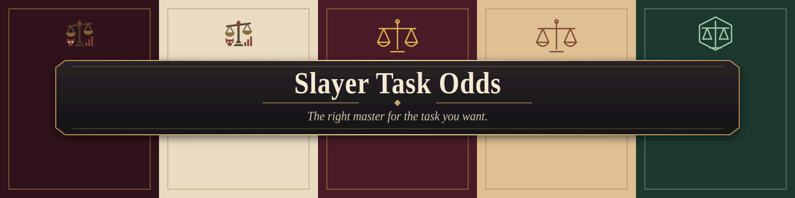
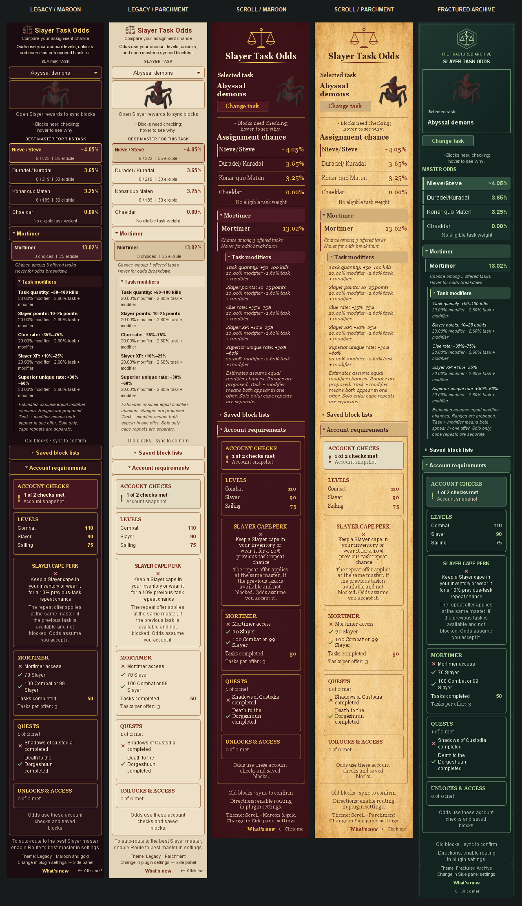
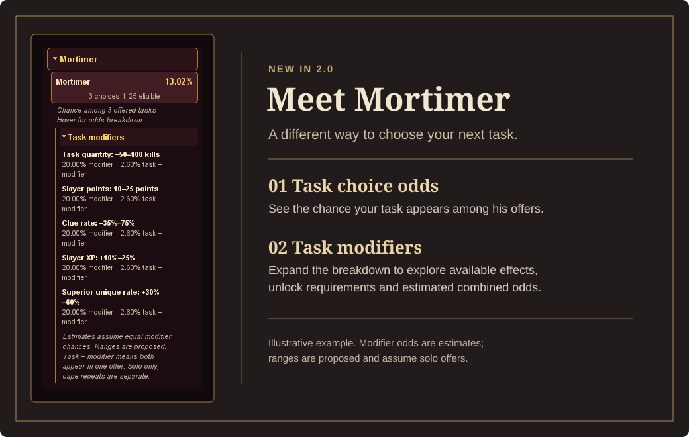

Compare the chance of getting a Slayer task from each master. Odds use your account's levels, quests, unlocks, previous task and saved block lists.

## What's new in 2.0

| | |
| :-- | :-- |
| **Added Mortimer and task modifiers** | Compare the chance of a task appearing among his choices, then expand the modifier breakdown for unlocks, proposed ranges and estimated odds. |
| **Character-specific block lists** | Block lists are saved per character. Sync a master's list from their task screen or edit it in the panel. |
| **Clearer odds and requirements** | Check account requirements, hover for explanations and see which masters have old or unconfirmed blocks. |
| **New panel themes and colours** | Choose from Legacy, Scroll and Fractured Archive, with parchment or maroon and gold options for Legacy and Scroll. |
| **Choose masters and routes** | Select which masters to compare and optionally route to the best one with Shortest Path. |

## Five looks, one calculator

**Legacy** brings back the familiar cards. **Scroll** gives the panel a weathered-paper look. Both come in maroon and gold or parchment. **Fractured Archive** has its own layout, vault seal and green palette.

The previews use illustrative account data. In **Side panel** settings, select **Panel Theme** and, for Legacy or Scroll, **Theme Colours**. Fractured Archive has its own fixed colours.

## Install

In RuneLite, open the **Plugin Hub**, search for **Slayer Task Odds** and install it. Open the scales icon in the sidebar.

## Use

1. Choose a task to see each master's odds, ranked from highest to lowest.
2. Open a master's **Slayer rewards → Tasks** screen to sync their blocks. You can also edit them under **Saved block lists**.
3. Expand **Account requirements** to check the levels, quests, unlocks and access used in the calculation. Hover over a result for its explanation.

The panel can hide masters at 0.00%, show their reasons on request, and post block-sync confirmations, failures and reminders to chat. These options are in the plugin settings.

Each master's blocks affect that master's odds. Until a list is confirmed for your character, its result is marked approximate; imported or older saved blocks remain in use, while an empty list is assumed if none exists.

Use **Enable/Disable Masters** to choose which masters appear in the comparison and can be selected for automatic routing. All are enabled by default.

## Mortimer and task modifiers

Mortimer's percentage is the chance of a task appearing among his offered choices. His separate block list and completed-task count are included. Expand **Task modifiers** beneath Mortimer to see unlocks, proposed effect ranges and estimated chances of a task appearing with each applicable modifier. The estimates assume solo offers and equally likely applicable modifiers; cape repeats are separate. Enable or disable Mortimer under **Enable/Disable Masters**. Under Side panel, **Collapsible Mortimer section** controls whether he has a collapsible header; when disabled, his card stays visible without the header. **Show Mortimer task modifiers** controls the breakdown.

**How the estimates work:** We built the Mortimer calculator for this plugin using published task weights and a weighted selection model. The maths has been tested against that model, but the game's exact selection process has not been independently confirmed, so treat the displayed chances as estimates. Modifier calculations assume applicable unlocked modifiers are equally likely; the ranges are based on [Jagex's proposed values](https://secure.runescape.com/m=news/meet-mortimer-your-newest-slayer-master?oldschool=1) and may differ from the live game. We welcome reports of differences.

### Routing

Enable **Route to best master** under **General** to send the highest-odds eligible master's location to the [Shortest Path plugin](https://github.com/Skretzo/shortest-path). **Route to Mortimer** is a separate option and is off by default. Visit Mortimer once with the plugin enabled to save his location.

## Data and credits

Odds are calculated locally using bundled task data based on the [OSRS Wiki Slayer task weight calculator](https://oldschool.runescape.wiki/w/Calculator:Slayer/Slayer_task_weight). Wiki changes reach the plugin through releases. Monster portraits are bundled with the plugin.

Developed by Razza98, with AI assistance for parts of the code and graphics. The plugin's features, logic, layout and settings were designed and developed by the author.

The code is licensed under BSD 2-Clause. Wiki data attribution and generation notes are in [tools/wiki-reference/README.md](tools/wiki-reference/README.md), and portrait sources are in [ASSET-NOTICES.md](ASSET-NOTICES.md).

[Report a bug or suggest an improvement](https://github.com/RYANOATES/Slayer-Task-Odds/issues)

For release testing, see the [in-game checklist](docs/release-test-checklist.md).
