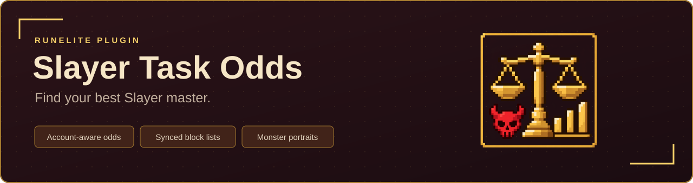
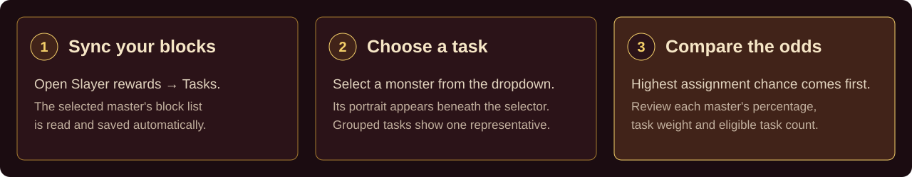
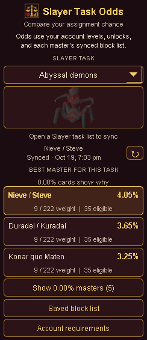

  <a href="https://runelite.net/plugin-hub">RuneLite Plugin Hub</a> ·
  <a href="#install">Install</a> ·
  <a href="#use-the-panel">Panel guide</a> ·
  <a href="CHANGELOG.md">Version changes</a> ·
  <a href="https://github.com/RYANOATES/Slayer-Task-Odds/issues">Report an issue</a>

Compare your chance of receiving a Slayer task from each master. Slayer Task Odds
uses your account’s levels, quest progress, unlocks, and saved block lists to rank
the available masters for the task you select.

| Feature | What it does |
| --- | --- |
| Master rankings | Orders masters by assignment chance, with odds shown to two decimal places. |
| Account requirements | Uses your levels, quest progress, unlocks and detected access conditions. |
| Separate block lists | Saves each master's blocks and supports manual edits for planning. |
| Zero odds explanations | Hover a master card to see whether a task is blocked, has unmet requirements, or is never assigned. |
| Zero odds display | Shows a brief reason on each 0.00% card, with an option to collapse masters whose displayed odds round to 0.00%. Expand them using the panel’s Show 0.00% masters button. |
| Route to best master | Optional setting sends the highest ranked Slayer master's location to the Shortest Path plugin when your selected task or top master changes. |
| Sync status | Shows the last master successfully synced and the date and time. |
| Monster portraits | Includes 147 local portraits; grouped tasks use a representative creature. |
| Local calculations | Bundles task data and images, with no external account-data requests. |

## Install

In RuneLite, open the **Plugin Hub**, search for **Slayer Task Odds**, and install
it. Open its gold scales and red skull icon in the sidebar to use the panel.

## Use the panel

1. Choose a monster from the **Slayer Task** dropdown. The panel starts with a
   selection prompt, so routing waits until you choose a task.
2. Compare the masters, ranked from the highest assignment chance to the lowest.
3. Open **Account requirements** to see which levels, quests, unlocks, or access
   checks affect your eligible task pool.

The burgundy-and-gold panel shows a portrait for the selected task. Grouped
assignments use a representative creature. Portraits are bundled with the plugin
and work without image downloads; task chances display to two decimal places.

  

*Preview rendered from the latest source with illustrative task weights and odds.
Your account's results will differ. The Plugin Hub version may lag behind the
source preview until the next release is approved.*

| Panel element | How to use it |
| --- | --- |
| Slayer task | Choose the assignment or boss you want to compare. |
| Portrait | Identify the selected task visually; the generic Boss entry uses the plugin icon. |
| Master cards | The highest-ranked master is highlighted in gold. Each card shows odds, weight information and eligible task count. |
| 0.00% tooltip | Hover the card to learn whether the task is blocked, which requirements are missing, or if the master never assigns it. Tiny chances that round to 0.00% are identified as available. |
| Saved block list | Open the rewards screen for a master to inspect or edit that master's saved blocks. |
| Account requirements | Expand to review the account checks used by the calculator. |

The percentage is the chance that a master assigns the selected task, based on
the task weights that apply to your account and that master’s saved block list.
Boss-task odds also account for the eligible boss subtable. The result is a
probability, not a promise about the next assignment.

Under **Side panel** in Plugin Configuration, enable **Route to best master** to
send the highest ranked master's location to the [Shortest Path plugin](https://github.com/Skretzo/shortest-path).
The route follows your selected task's best master, not a monster location. If
another plugin or a manual map click changes the Shortest Path destination,
Slayer Task Odds waits until you select another task or the top master changes
before requesting a new route. This option is off by default.
Turning it off stops new route requests; clear an existing route in Shortest
Path if you no longer want it displayed.

## Keep your block lists current

Open **Slayer rewards > Tasks** or the Slayer task-list screen while logged in.
The plugin detects the selected master and syncs its six regular block slots and
diary slot. It only updates the saved list after it has read and verified all
seven slots.

Use **Saved block list** in the panel or the master sections in Plugin
Configuration to review or edit saved blocks. This also lets you compare planned
block lists. Lists are kept separately for each Slayer master.

By default, a successful sync posts a confirmation and each slot in chat. To
silence those success messages, turn off **Post sync messages in chat** under
**Notifications** in Plugin Configuration. Sync failures are still reported.
The panel also shows the last successfully synced master and timestamp, including
after restarting RuneLite.

## Calculation and account data

Task weights and eligibility rules are based on the [OSRS Wiki Slayer task weight
calculator](https://oldschool.runescape.wiki/w/Calculator:Slayer/Slayer_task_weight).
The plugin calculates locally from task data bundled with the plugin and account
information already available in RuneLite. It does not send your account state to
an external service.

Task weights and requirements are bundled snapshots, updated through plugin
releases. The plugin does not fetch live calculator changes from the Wiki.

The **Account requirements** section shows the levels, quests, unlocks, and access
checks used for the selected account. Some access checks depend on information
RuneLite has observed; if an older item unlock is not detected, open your bank so
the client can see the relevant item.

## Credits and licensing

The Java plugin code is licensed under the BSD 2-Clause License. The bundled
Slayer task data is derived from OSRS Wiki content and is covered separately by
CC BY-NC-SA 3.0. Source references, attribution, and data-generation notes are in
[`tools/wiki-reference/README.md`](tools/wiki-reference/README.md).

Monster portrait sources and copyright notices are documented in
[`ASSET-NOTICES.md`](ASSET-NOTICES.md).

## Support

Report a bug or suggest an improvement on the [GitHub issue tracker](https://github.com/RYANOATES/Slayer-Task-Odds/issues).
